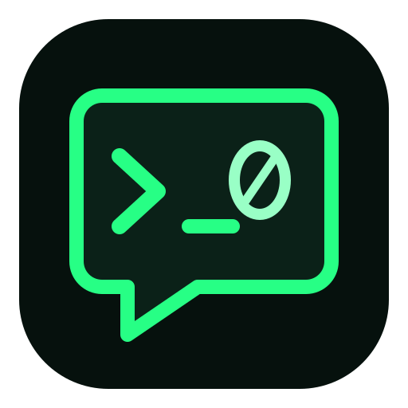

# NullWire for Ubuntu



NullWire is an independent Telegram API desktop client being prepared for Ubuntu 26.04 amd64. The intended release is built from Telegram Desktop sources, installed as a native Debian package, and updated through a signed Open Build Service APT repository. It is not affiliated with Telegram.

**Status: isolated source build verified; there is no released production package yet.** An initial upstream-binary repack reached a successful OBS staging build, but it was superseded by the source-build requirement and must not be released. The source-built test deb passed installation and offline-window checks; production APT installation, GPU playback and Snap migration are not complete. See [verification status](docs/STATUS.md).

## Intended behavior

Hardware video decoding defaults to enabled on Linux. The upstream selection code tries VA-API, VDPAU and CUDA where the codec, GPU and installed drivers support them, retaining software fallback. Saved user settings remain authoritative. UI rendering and video decoding are separate capabilities; a working OpenGL driver alone does not prove hardware video playback.

The package must provide the required runtime libraries without forcing an Intel, AMD or NVIDIA driver onto every machine. Tests on one GPU do not establish support for all GPU and codec combinations. Existing Snap profiles will be backed up and verified before any migration.

## Build and release design

- OBS builds the source packages. The stable project has direct building disabled; staging publishing is disabled.
- The small external trigger may check releases and start OBS jobs. It must not compile applications or run package/GUI verification containers on the trigger host.
- Local verification must check the exact resulting deb, install it, require a visible window and test removal/reinstallation before release.
- Production source builds need this application's own Telegram API identity. Test API credentials cannot be used in a public release. Private identifiers and user data must stay outside this repository and public source logs.
- NullWire uses its own name and icon and preserves upstream functionality, license notices and source availability.

The source pipeline is not yet complete. `tools/pipeline.py` retains the OBS primitives and the historical repack experiment for inspection; its CLI prevents using that experiment to publish a release. Do not bypass the source-release guards.

## Development and local checks

This project requires TDD for executable behavior. Follow [the testing policy and evidence](docs/TESTING.md): demonstrate a relevant failing test before implementation, then make it pass and keep the focused checks green.

```sh
export TMPDIR=/srv/temp/telegram
mkdir -p "$TMPDIR"
python3 -m unittest discover -s tests -v
bash -n tools/*.sh
```

The `packaging/source/debian/` recipe is an isolated build test using the limited sample API identity. OBS built `7.4.1-obs3.test10` successfully, and the exact deb passed clean installation, offline visible-window and remove/reinstall checks. It still must not be used for login, migration or a stable release.

The Linux hardware-decoding default patch is in `packaging/source/debian/patches/`. It was checked against the exact upstream 7.4.1 full-source archive with zero patch fuzz; this check is not a compilation or playback test.

`.state/` is private scratch. It can contain OBS cookies, downloaded archives and migration backups; it is excluded from Git and Docker build contexts. Do not upload it.

## Documentation

- [Current status and remaining acceptance checks](docs/STATUS.md)
- [Architecture and source-build decisions](docs/ARCHITECTURE.md)
- [Local operations and migration record, in Russian](docs/OPERATIONS_RU.md)
- [Upstream Telegram Desktop](https://github.com/telegramdesktop/tdesktop)
- [Telegram API registration](https://core.telegram.org/api/obtaining_api_id)
- [Telegram API terms](https://core.telegram.org/api/terms)
- [OBS project](https://build.opensuse.org/project/show/home:dwolfF:telegram)

Packaging and original NullWire assets are GPL-3.0-or-later. Upstream software retains its own licenses, including Telegram Desktop's GPLv3 with its OpenSSL exception. The complete corresponding sources and notices must accompany any eventual binary release.
